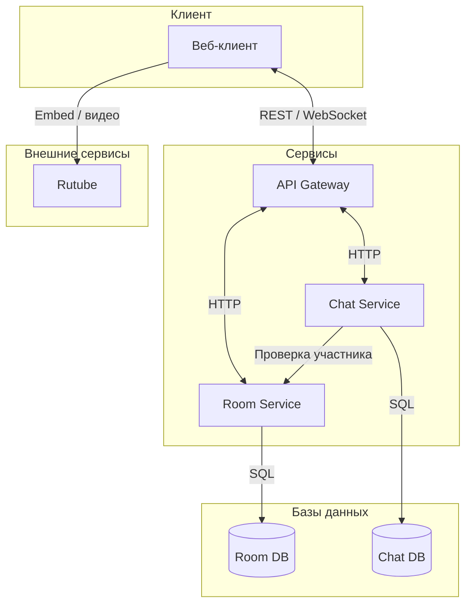
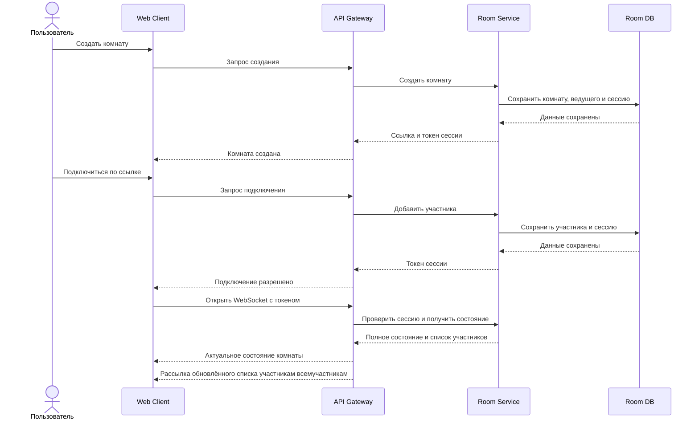
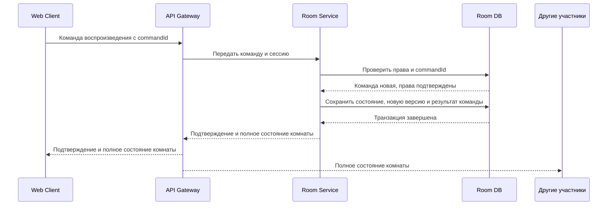
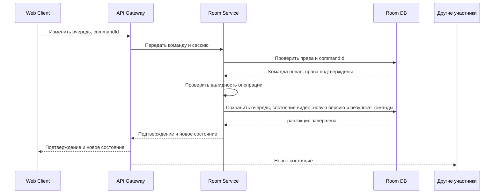
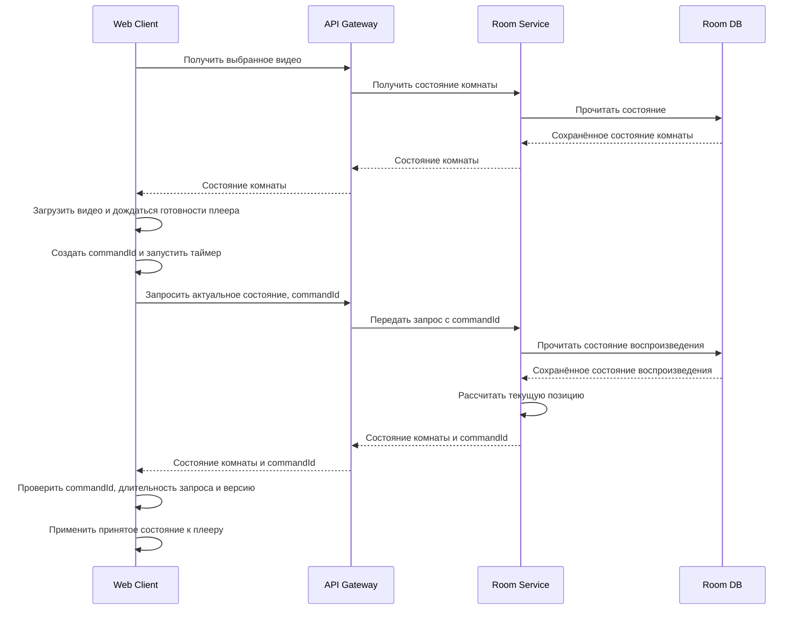
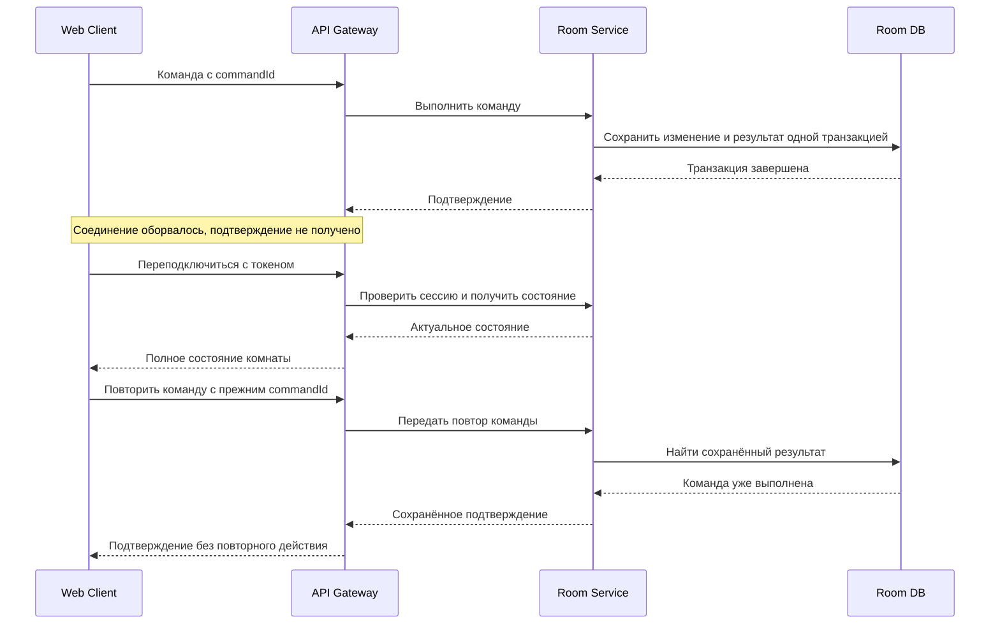
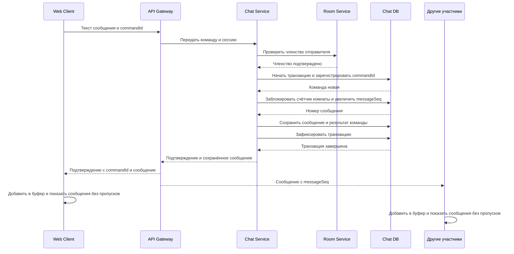
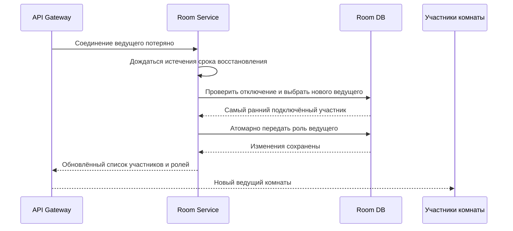
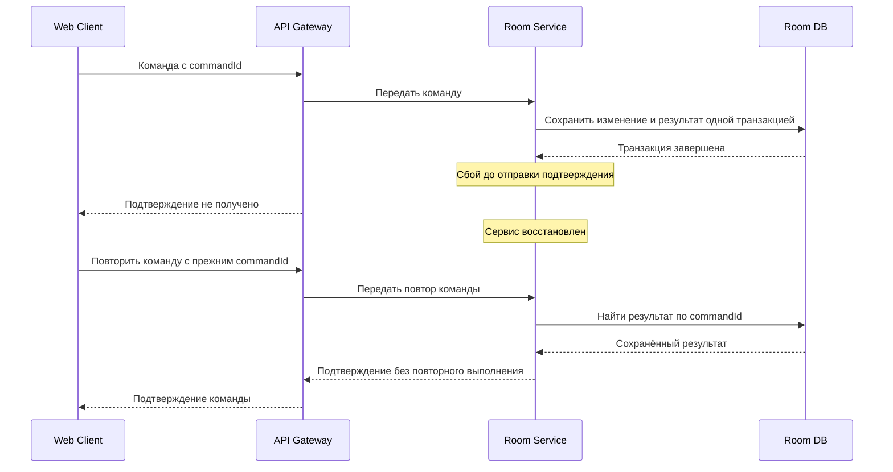

# Техническое решение проекта «Plotina»

## Введение
- **Цель проекта:**  
  реализовать прототип распределённой системы для совместного просмотра видео с синхронизацией плееров, чатом и общей очередью.

- **Основания для разработки:**  
  учебный проект по курсу «Распределенные системы»

- **Команда:**  
	Носиков Дмитрий - TeamLord
	Могильников Дмитрий - VibeMan
	Удоденко Елена - VibeWoman
	Мамонтова Арина - VibeWoman2

---

## Глоссарий
| Термин             | Определение                                                                                                |
| ------------------ | ---------------------------------------------------------------------------------------------------------- |
| Комната            | Общее пространство, в котором пользователи смотрят видео и общаются.                                       |
| Ведущий            | Участник с назначенной системной ролью, который может изменять параметры комнаты.                          |
| Участник           | Пользователь, подключённый к комнате просмотра.                                                            |
| Очередь видео      | Упорядоченный список видео, подготовленных для просмотра в комнате.                                        |
| Состояние комнаты  | Текущее видео, позиция воспроизведения, состояние паузы, версия состояния и очередь.                       |
| Событие            | Сообщение об изменении в комнате: новое сообщение, пауза, перемотка или изменение очереди.                 |
| WebSocket          | Постоянное двустороннее соединение между клиентом и сервером для обмена сообщениями в реальном времени.    |
| Синхронизация      | Передача сервером актуального состояния комнаты подключённым участникам.                                   |
| Embed-плеер        | Встроенный на страницу видеоплеер Rutube, воспроизводящий видео на стороне Rutube.                         |
| Потоковая передача | Передача видео частями по мере воспроизведения, без загрузки всего файла перед началом просмотра.          |
| Идемпотентность    | Свойство повторного запроса, при котором он не приводит к повторному применению уже выполненного действия. |

---

## Функциональные требования
Система должна предоставлять следующие функции:
1. Создание комнаты и подключение к ней по ссылке или идентификатору.
2. Просмотр видео по ссылке на Rutube.
3. Совместное управление воспроизведением: запуск, пауза, перемотка и переход к следующему видео.
4. Добавление видео в очередь, удаление и изменение порядка видео.
5. Отправка и получение сообщений в чате комнаты.
6. Отображение списка участников комнаты и их подключения.
7. Повторная синхронизация состояния плеера при подключении пользователя или восстановлении соединения.
8. Возможность изменять параметры комнаты ведущим.
9. Возможность выбрать режим управления воспроизведением:
- только ведущий;
- все участники.
10. Режим управления воспроизведением выбирает ведущий. В режиме «только ведущий» только он может управлять воспроизведением и очередью.
11. В режиме «все участники» управлять воспроизведением и очередью могут все участники.
12. При выходе ведущего его роль передаётся участнику, который подключился к комнате раньше остальных.
---

## Нефункциональные требования
- Согласованность: сервер является источником актуального состояния комнаты. Клиенты получают изменения от сервера и не считают локальное состояние плеера главным. После получения обновлений все участники должны иметь одинаковое выбранное видео и состояние воспроизведения.
- Синхронизация: при стабильном соединении разница позиций воспроизведения у участников не должна превышать 2 секунд. Задержки загрузки и буферизации учитываются отдельно.
- Позднее подключение: если видео уже воспроизводится, новый участник начинает просмотр с текущей позиции комнаты, а не с начала видео. 
- Ненадёжная доставка: WebSocket-соединение может оборваться, поэтому при переподключении клиент получает полное актуальное состояние комнаты из REST API или отдельного WebSocket-события. Команды, на которые клиент не получил подтверждение, повторяются с тем же уникальным идентификатором. Сервер не применяет повторно команду с уже обработанным идентификатором.
- Безопасность: при создании комнаты и подключении к ней сервер выдаёт пользователю уникальный токен сессии. При каждом запросе или WebSocket-команде клиент передаёт этот токен, а сервер по нему определяет пользователя, комнату и его роль. Сервер принимает команду только от участника этой комнаты и только если его роль позволяет выполнить это действие. Роли назначаются и хранятся на сервере: клиент не может получить права ведущего, указав их в запросе.
- Порядок событий: команды внутри одной комнаты сервер обрабатывает последовательно по мере их поступления.
- Обработка версий клиентом: более новая stateVersion обновляет полное состояние комнаты, более старая игнорируется. Ответ с той же версией используется для сравнения позиции плеера с текущей серверной позицией и коррекции при превышении порога отклонения. При пропуске промежуточных версий клиент применяет полный новый снимок без воспроизведения пропущенных команд. Запрос состояния и течение воспроизведения сами по себе не увеличивают stateVersion.
- Сообщения чата: сообщения не входят в stateVersion комнаты. Каждое сообщение получает messageSeq — последовательный номер внутри комнаты, сохраняющийся при повторах. После подключения клиент отображает сообщения последовательно после полученного начального номера. Более поздние сообщения буферизуются до получения пропущенных через Chat Service. История до подключения и за время отключения не загружается.

---

## Пользовательские сценарии
### Сценарий: создание комнаты и подключение участника
1. Пользователь создаёт комнату в клиентском приложении.
2. Сервер создаёт комнату и возвращает её идентификатор и ссылку для приглашения.
3. Другой пользователь открывает ссылку и подключается к комнате.
4. Сервер передаёт ему текущее состояние комнаты, список участников и очередь видео.

### Сценарий: изменение очереди
1. Пользователь с нужными правами добавляет, удаляет или перемещает видео в очереди.
2. Клиент отправляет команду серверу с идентификатором команды.
3. Сервер проверяет права пользователя и изменяет очередь.
4. Сервер увеличивает версию состояния.
5. Сервер рассылает новую версию состояния.
6. Все участники видят одинаковый порядок видео.
Если удалить текущее видео, сервер переключает комнату на следующее видео и ставит его на паузу. Если следующего видео нет, воспроизведение останавливается, а текущее видео сбрасывается.

### Сценарий: совместный просмотр видео по ссылке
1. Ведущий добавляет в очередь ссылку на видео из Rutube.
2. Клиент передаёт ссылку серверу.
3. Сервер проверяет формат ссылки и сохраняет видео в очереди комнаты.
4. Ведущий запускает видео.
5. Сервер сохраняет текущее состояние воспроизведения и рассылает участникам новую версию состояния.
6. Клиенты открывают видео во встроенном плеере и синхронизируют позицию воспроизведения.

### Сценарий: управление воспроизведением
1. Участник нажимает «Пауза», «Продолжить», «Перемотать» или «Следующее видео».
2. Клиент отправляет команду серверу через WebSocket.
3. Сервер проверяет права пользователя и обновляет состояние комнаты.
4. Сервер рассылает новую версию состояния участникам.
5. Клиенты применяют изменение к своему плееру.
Применение команды "Следующее видео" переключает видео на следующее в очереди. Если следующего видео в очереди нет, воспроизведение останавливается, а текущее видео сбрасывается.

### Сценарий: чат комнаты
1. Участник вводит сообщение в чат.
2. Клиент отправляет сообщение серверу.
3. Сервер проверяет, что пользователь подключён к комнате, сохраняет сообщение и рассылает его подключённым участникам.
4. Клиент показывает сообщения последовательно по messageSeq. При пропуске номера следующие сообщения ожидают в буфере, а клиент запрашивает недостающие. После переподключения клиент получает новый начальный номер без загрузки истории за время отключения. Сообщения с номерами не больше начального игнорируются, включая повторные рассылки.

### Сценарий: восстановление соединения
1. У клиента пропадает соединение с сервером.
2. Клиент пытается подключиться повторно.
3. После переподключения клиент запрашивает актуальное состояние комнаты.
4. Сервер возвращает текущее видео, позицию, состояние воспроизведения и очередь.
5. Если клиент не получил подтверждение ранее отправленной команды, он через некоторое время автоматически повторно отправляет её с тем же идентификатором.
6. Сервер проверяет идентификатор команды. Если команда уже была выполнена, сервер не выполняет её повторно и отправляет клиенту подтверждение.
7. После получения подтверждения клиент обновляет состояние плеера и использует новый идентификатор для следующей команды пользователя.

### Сценарий: передача роли ведущего
1. Ведущий покидает комнату.
2. Сервер определяет участника, который подключился к комнате раньше остальных.
3. Сервер назначает выбранного участника новым ведущим.
4. Сервер уведомляет участников об изменении роли.

---

##  Архитектура системы
Основные компоненты:
1. Web Client — веб-клиент, предоставляющий интерфейс комнаты, очереди и чата; управляет встроенным плеером Rutube по серверному состоянию.
2. API Gateway — входная точка в систему; принимает REST-запросы и WebSocket-команды, маршрутизирует их в сервисы и рассылает события участникам.
3. Room Service — основной сервис, управляющий комнатами, участниками, ролями, очередью и воспроизведением; проверяет права, последовательно обрабатывает команды и предотвращает их повторное выполнение.
4. Chat Service — сервис сообщений; проверяет членство отправителя, сохраняет сообщения с защитой от дублей и передаёт их API Gateway для рассылки.
5. Room DB — транзакционная база данных Room Service; хранит комнаты, участников, сессии, очередь, состояние воспроизведения и результаты обработки команд.
6. Chat DB — база данных Chat Service; хранит сообщения и результаты обработки команд отправки.
7. Rutube — внешняя видеоплатформа, предоставляющая встроенный плеер и видеопоток непосредственно браузеру пользователя.

### Согласованность состояния комнаты и порядок команд
- Проблема: несколько участников могут одновременно отправлять команды управления видео и очередью; их локальные состояния могут различаться.
- Решение: Room Service является источником актуального состояния комнаты. В прототипе работает один экземпляр сервиса с отдельной очередью для каждой комнаты: команды, включая передачу роли ведущего, выполняются строго последовательно. Проверка актуальных прав, изменение состояния, увеличение stateVersion и сохранение результата выполняются одной транзакцией. В БД каждого сервиса действует уникальное ограничение на commandId. Регистрация commandId и изменение данных выполняются одной транзакцией, поэтому одновременно поступившие копии не выполняются повторно. Это правило действует и в Chat Service. После фиксации изменений сервер рассылает полное состояние: более новая версия обновляет комнату, та же допускается для коррекции позиции, старая игнорируется.
- Гарантия: изменения внутри комнаты не конфликтуют из-за одновременной записи, повтор команды не вызывает повторного действия, пока её результат хранится в БД. Клиенты, получившие одинаковую версию, имеют одинаковые выбранное видео, очередь и параметры воспроизведения.
- Компромиссы: медленная команда задерживает следующие команды комнаты; порядок определяется очередью и может отличаться от порядка нажатий в браузерах. Запуск нескольких экземпляров Room Service потребует дополнительной координации.

### Модели согласованности комнаты и чата
- Проблема: состояние комнаты распространяется с задержками, а сообщения чата должны записываться и отображаться в едином порядке с сохранением порядка отправки каждого участника.
- Решение: для состояния комнаты используется eventual consistency: рассылка и периодическая сверка приводят клиентов к актуальному полному состоянию. Для чата используется единый порядок messageSeq, назначаемый одной транзакцией с сохранением сообщения и блокировкой счётчика комнаты. При подключении клиент получает текущий номер как начальный и затем отображает сообщения последовательно, без пропусков. Более поздние сообщения ожидают в буфере, недостающие запрашиваются через Gateway у Chat Service.
- Гарантия: после прекращения изменений и восстановления обмена клиенты сходятся к состоянию комнаты. В течение текущего подключения клиент отображает непрерывную последовательность сообщений после начального номера, без перестановки уже показанных. Порядок сообщений каждого отправителя сохраняется: следующее сообщение отправляется после подтверждения и отображения предыдущего в общей последовательности.
- Компромиссы: потеря сообщения задерживает отображение следующих до восстановления пропуска. При недоступности Chat Service показ новых сообщений может приостановиться. После переподключения устанавливается новый начальный номер; история за время отключения не загружается. Гарантия последовательного чтения относится к текущему подключению, а не ко всей истории между переподключениями.

### Синхронизация воспроизведения
- Проблема: участники подключаются в разное время, получают события с разной задержкой и испытывают буферизацию, поэтому позиции их плееров могут расходиться.
- Решение: сервер хранит позицию воспроизведения на момент последнего изменения, время её фиксации и состояние паузы. При подключении, получении обновления и периодической сверке клиент корректирует позицию плеера. Интервал сверки и порог коррекции выбираются с запасом относительно допустимого расхождения 2 секунд.
- Гарантия: при стабильном соединении, отсутствии буферизации и задержках в пределах предусмотренного запаса разница позиций воспроизведения участников не превышает 2 секунд. Недавно вошедший участник после загрузки видео и применения состояния начинает просмотр с текущей позиции комнаты.
- Компромиссы: уменьшение времени расхождения требует более частых сверок и коррекций. При буферизации или превышении допустимых задержек расхождение может временно превысить 2 секунды; после восстановления нормальной работы клиент повторно синхронизирует плеер. Коррекция может вызывать заметные перемотки.

### Доставка команд и идемпотентность
- Проблема: сервер может выполнить команду, но подтверждение потеряется при обрыве связи. Повтор команды «Следующее видео» способен переключить видео дважды.
- Решение: каждому новому действию клиент назначает уникальный commandId до отправки, при повторе сохраняет прежний ID. Новые команды управления комнатой могут отправляться без ожидания подтверждения предыдущих. Для чата клиент отправляет следующее сообщение после подтверждения и отображения предыдущего в общей последовательности messageSeq.Каждое новое действие получает собственный commandId, повтор сохраняет прежний. Room Service и Chat Service сохраняют результат команды одной транзакцией с изменением данных на всё время жизни комнаты. Повтор возвращает сохранённый результат, другие параметры с тем же ID отклоняются. После завершения комнаты команды отклоняются. Периодическая сверка приводит клиент к полному актуальному состоянию комнаты.
- Гарантия: повторная отправка не вызывает повторного изменения состояния или создания сообщения в течение жизни комнаты; после её завершения старые команды не выполняются.
- Компромиссы: результаты команд занимают место в БД до завершения комнаты. При недоступности сервиса подтверждение и восстановление актуального состояния могут задерживаться.

### Обработка частичных отказов
- Проблема: браузер, отдельный сервис или Rutube могут стать недоступны; таймаут не позволяет определить, выполнилась ли команда.
- Решение: используются таймауты внутренних запросов, WebSocket heartbeat и переподключение. Неподтверждённые команды повторяются с прежним commandId. После восстановления клиент получает актуальное состояние. Сохранённые данные сервисов восстанавливаются из БД после перезапуска.
- Гарантия: потеря соединения одного участника не останавливает остальных. Отказ Chat Service не блокирует управление видео. Перезапуск сервисов не удаляет уже сохранённое состояние при сохранности БД.
- Компромиссы: отказ API Gateway разрывает все его соединения; отказ Room Service блокирует управление комнатами и проверку членства для новых сообщений. Без реплик отказ PostgreSQL временно делает операции с БД недоступными.

### Обнаружение отключений и передача ведущего
- Проблема: сервер должен передать роль ушедшего ведущего, но краткий обрыв сети не должен вызывать постоянную смену ведущих.
- Решение: при явном выходе роль передаётся сразу; при потере соединения используется период ожидания, 10 секунд. После его истечения Room Service выбирает самого раннего из оставшихся подключённых участников. Проверка и назначение выполняются в одной итерации.
- Гарантия: в комнате назначен не более чем один ведущий; краткое отключение в пределах периода ожидания не вызывает передачу роли.
- Компромиссы: при сетевом сбое передача роли происходит с задержкой. Если ведущий вернулся после передачи, он становится обычным участником.

---

## Технические сценарии

### 1. Создание комнаты и подключение участника
1. Клиент отправляет запрос через API Gateway.
2. Room Service создаёт комнату, назначает ведущего и сохраняет данные в Room DB.
3. Подключающийся участник получает токен сессии.
4. Новый участник получает текущее состояние комнаты, очередь видео и список участников.
5. Остальные участники получают обновлённый список участников комнаты.

### 2. Управление воспроизведением
1. Клиент отправляет команду с уникальным commandId.
2. Room Service проверяет актуальные права и последовательно обрабатывает команду в очереди комнаты.
3. Состояние, новая версия и результат команды сохраняются одной транзакцией.
4. После фиксации транзакции Gateway получает подтверждение и рассылает полное состояние комнаты участникам.
5. Клиенты применяют более новую версию состояния. Та же версия допускается для коррекции позиции плеера, более старая игнорируется.
6. Если сервис упал после записи в БД, но до рассылки, участники получают полное актуальное состояние при очередной периодической сверке после восстановления сервиса. 

### 3. Изменение очереди видео
1. Клиент отправляет команду добавления, удаления или перемещения видео.
2. Room Service проверяет права, валидность операции и commandId.
3. Изменения очереди, новая версия и результат команды сохраняются одной транзакцией.
4. Gateway рассылает новое состояние участникам.

### 4. Позднее подключение и синхронизация плеера
1. Клиент получает выбранное видео, загружает его и ожидает готовности плеера.
2. После готовности отправляет запрос состояния с новым commandId и запускает таймер.
3. Room Service рассчитывает текущую позицию и возвращает состояние вместе с commandId.
4. Если время ожидания превышено, клиент игнорирует поздний ответ и через паузу отправляет новый запрос с новым commandId.
5. По своевременному ответу клиент устанавливает позицию и состояние воспроизведения. Если видео изменилось, загружает его и повторяет запрос после готовности.
6. Во время просмотра клиент периодически повторяет сверку и корректирует позицию при превышении порога отклонения. Ответ с той же stateVersion используется для коррекции позиции, с более старой — игнорируется.

### 5. Восстановление соединения и повтор команды

1. После обрыва клиент переподключается с токеном сессии.
2. Получает актуальное состояние комнаты.
3. Повторяет неподтверждённую команду с прежним commandId.
4. Room Service возвращает сохранённый результат либо выполняет ещё не обработанную команду.
5. Клиент не заменяет новое состояние устаревшей версией из подтверждения.

### 6. Отправка сообщения в чат
1. При подключении Gateway начинает буферизовать сообщения чата для клиента и получает от Chat Service текущий messageSeq как начальный номер. Клиент ожидает следующий номер; сообщения с номерами не больше начального игнорируются.
2. Клиент создаёт команду отправки с уникальным commandId. Следующее сообщение отправляется после подтверждения и отображения предыдущего в общей последовательности. При повторе сохраняется прежний commandId.
3. Chat Service проверяет членство отправителя через Room Service и наличие результата команды. Для новой команды назначает следующий messageSeq. Регистрация commandId, увеличение счётчика, сохранение сообщения и результата выполняются одной транзакцией с блокировкой строки счётчика комнаты.
4. Gateway отправляет подтверждение автору и рассылает сообщение участникам. Все клиенты, включая автора, показывают сообщения только последовательно по messageSeq, без пропусков. До этого собственное сообщение может отображаться только отдельно как ожидающее отправки.
5. Если пришёл номер больше ожидаемого, клиент сохраняет сообщение в буфере и запрашивает пропущенные через Gateway у Chat Service. Сервис возвращает их из Chat DB. После получения пропуска клиент показывает накопленные сообщения по порядку.
6. Клиент периодически запрашивает текущий messageSeq и проверяет наличие пропусков. Это позволяет обнаружить потерянное последнее сообщение, даже если следующие сообщения не поступают.
7. При повторе команды возвращается сохранённое сообщение с прежним messageSeq, Gateway повторно рассылает его. Клиент игнорирует уже отображённые номера и не добавляет дубли в буфер. После переподключения устанавливается новый начальный номер без загрузки истории за время отключения.

### 7. Отключение ведущего и передача роли
1. Каждая вкладка подключается как отдельный участник со своим токеном сессии и одним активным WebSocket-соединением. Отключение одной сессии не затрагивает другие вкладки и комнаты.
2. Gateway обнаруживает потерю соединения и сообщает Room Service. Если отключился ведущий, сервис запускает период ожидания восстановления.
3. При переподключении с прежним токеном Gateway сообщает Room Service о восстановлении соединения. Участник отмечается подключённым, ожидающая передача роли отменяется.
4. По истечении периода ожидания проверка и передача роли выполняются в очереди комнаты одной транзакцией: ожидание должно относиться к текущему отключению, участник всё ещё должен быть отключён и оставаться ведущим.
5. Если условия выполнены, роль получает самый ранний из оставшихся подключённых участников. Gateway рассылает обновлённый список участников и ролей.
6. При явном выходе ведущего роль передаётся без ожидания. Если прежний ведущий возвращается после передачи роли, он остаётся обычным участником.

### 8. Частичный отказ и восстановление сервиса
1. Room Service становится недоступен, клиент не получает подтверждение команды.
2. После восстановления сервиса клиент запрашивает актуальное состояние.
3. Неподтверждённая команда повторяется с прежним commandId.
4. Room Service находит сохранённый результат и возвращает его без повторного выполнения.

---

## План разработки и тестирования

### Включает:

- Реализация Room Service для управления комнатами, участниками, ролями, очередью и воспроизведением.
- Реализация API Gateway для обработки REST-запросов, WebSocket-команд и рассылки обновлений.
- Интеграция Room Service с Room DB для хранения состояния комнат, сессий и результатов команд.
- Реализация Chat Service и интеграция с Chat DB для сохранения сообщений с защитой от дублей.
- Реализация веб-клиента со встроенным Rutube-плеером, очередью, чатом и списком участников.
- Поддержка синхронизации плееров, восстановления соединения и передачи роли ведущего.

### План разработки:

- Проектирование REST API, WebSocket-команд и событий.
- Проектирование структуры Room DB и Chat DB.
- Реализация API Gateway: маршрутизация, проверка сессий, WebSocket-соединения и heartbeat.
- Реализация создания комнат, подключения участников и выдачи токенов сессий в Room Service.
- Реализация ролей и режимов управления: «только ведущий» и «все участники».
- Реализация управления воспроизведением и очередью видео.
- Реализация последовательной обработки команд комнаты, версионирования состояния и идемпотентности по commandId.
- Интеграция Room Service с Room DB: сохранение изменений и результата команды одной транзакцией.
- Реализация Chat Service: проверка членства, транзакционное назначение messageSeq и сохранение сообщений, выдача начального номера при подключении и восстановление пропусков текущего подключения. Реализация клиентского буфера для отображения сообщений без пропусков.
- Реализация веб-клиента и управления встроенным Rutube-плеером по серверному состоянию.
- Реализация синхронизации при подключении и периодической сверки позиции воспроизведения.
- Реализация переподключения и повторной отправки неподтверждённых команд с прежним commandId.
- Реализация передачи роли ведущего при выходе или длительном отключении.
- Документирование API, настроек и порядка запуска проекта.

### План тестирования:

- Модульные тесты логики очереди, проверки прав, расчёта позиции и выбора нового ведущего.
- Интеграционные тесты взаимодействия Room Service с Room DB, Chat Service с Chat DB и проверки членства через Room Service.
- Тесты API Gateway: корректные и некорректные запросы, недействительные токены и доступ к чужой комнате.
- Тест создания комнаты и подключения нескольких участников по ссылке.
- Тест управления воспроизведением и очередью в обоих режимах доступа.
- Тест идемпотентности: повтор команды с тем же commandId не вызывает повторного действия.
- Тест версионирования: клиент игнорирует устаревшее состояние и применяет более новое, даже если промежуточные версии пропущены.
- Тест позднего подключения: участник начинает просмотр с текущей позиции комнаты.
- Тест синхронизации: расхождение позиций не превышает 2 секунд при стабильном соединении.
- Тест порядка чата: при ожидаемом номере 11 доставить сообщение 12 и проверить, что оно не показывается до получения 11. После восстановления пропуска сообщения отображаются как 11 → 12.
- Тест отправки чата: одновременные сообщения получают разные messageSeq, порядок сообщений каждого отправителя сохраняется. Повтор команды возвращает прежний номер и не создаёт дубль.
- Тест потери последнего сообщения: периодическая проверка текущего messageSeq обнаруживает пропуск и восстанавливает сообщение без появления следующего.
- Тест переподключения чата: клиент получает новый начальный номер; сообщения за время отключения не загружаются и не появляются при запоздалой повторной рассылке.
- Тест восстановления соединения: клиент получает актуальное состояние и повторяет неподтверждённые команды без повторного выполнения.
- Тест передачи ведущего: явный выход или длительное отключение передаёт роль самому раннему подключённому участнику, краткий обрыв сохраняет роль.
- Тест частичного отказа: недоступность Chat Service не блокирует управление видео.
- Нагрузочное тестирование нескольких комнат с одновременными командами и сообщениями; фиксация задержек и ошибок.
- Проверка граничных случаев: неверная ссылка, несуществующая комната, пустая очередь, удаление текущего видео и отсутствие участников для передачи роли.

### Definition of Done (DoD):

- Создана комната, к ней подключены не менее трёх клиентов, всем отображается актуальный список участников.
- Выполнены запуск, пауза и перемотка; клиенты получили согласованное состояние воспроизведения.
- Выполнены добавление, удаление и перемещение видео; очередь совпадает у всех клиентов.
- При удалении текущего видео следующее выбирается с паузой; при отсутствии следующего текущее видео сбрасывается.
- В режиме «только ведущий» команда обычного участника отклоняется сервером; в режиме «все участники» принимается.
- Повтор команды «Следующее видео» с тем же commandId не вызывает второго переключения.
- Поздно подключившийся участник начинает просмотр с текущей позиции комнаты.
- В согласованных условиях проверки расхождение позиций плееров не превышает 2 секунд после начальной синхронизации.
- В течение текущего подключения сообщения чата отображаются последовательно по messageSeq без пропусков и перестановок уже показанных сообщений. Пропущенное сообщение восстанавливается до показа следующих.
- Порядок сообщений каждого отправителя сохраняется, собственные сообщения отображаются в общей последовательности. Повтор команды не создаёт новую запись, новый messageSeq или дубль в интерфейсе.
- После переподключения устанавливается новый начальный номер без загрузки истории за время отключения.
- После разрыва соединения клиент получил актуальное состояние и подтверждение повторно отправленной команды без повторного действия.
- После выхода ведущего роль передана самому раннему из оставшихся подключённых участников.
- При остановке Chat Service управление видео продолжает работать.
- После перезапуска Room Service сохранённое состояние комнаты восстановлено из БД.
