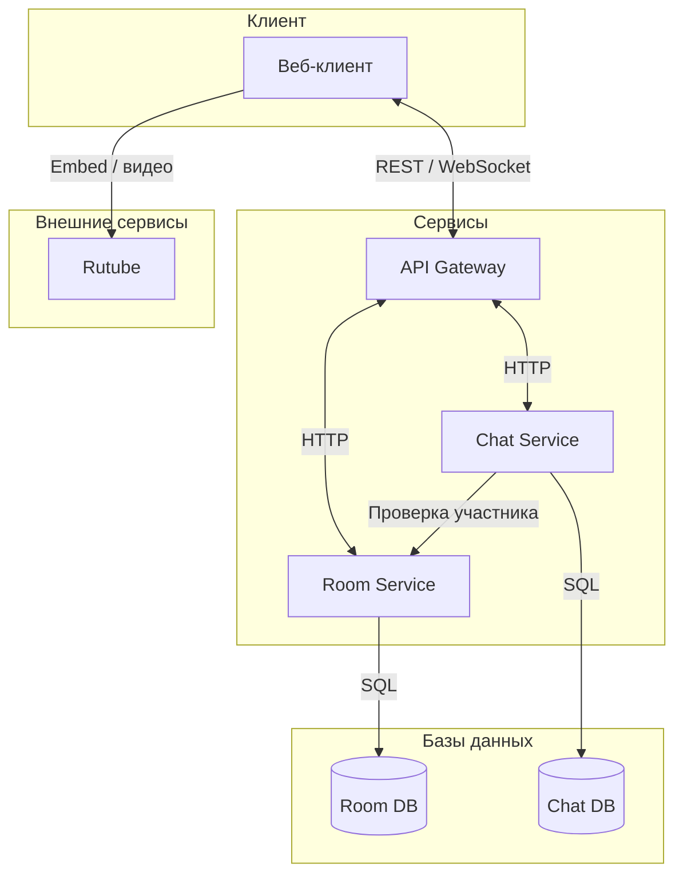

# Техническое решение проекта «Plotina»

## Введение
- **Цель проекта:**  
  реализовать прототип распределённой системы для совместного просмотра видео с синхронизацией плееров, чатом и общей очередью.

- **Основания для разработки:**  
  учебный проект по курсу «Распределенные системы»

- **Команда:**  
	Носиков Дмитрий - TeamLord
	Могильников Дмитрий - VibeMan
	Удоденко Елена - VibeWoman
	Мамонтова Арина - VibeWoman2

---

## Глоссарий
| Термин             | Определение                                                                                                |
| ------------------ | ---------------------------------------------------------------------------------------------------------- |
| Комната            | Общее пространство, в котором пользователи смотрят видео и общаются.                                       |
| Ведущий            | Участник с назначенной системной ролью, который может изменять параметры комнаты.                          |
| Участник           | Пользователь, подключённый к комнате просмотра.                                                            |
| Очередь видео      | Упорядоченный список видео, подготовленных для просмотра в комнате.                                        |
| Состояние комнаты  | Текущее видео, позиция воспроизведения, состояние паузы, версия состояния и очередь.                       |
| Событие            | Сообщение об изменении в комнате: новое сообщение, пауза, перемотка или изменение очереди.                 |
| WebSocket          | Постоянное двустороннее соединение между клиентом и сервером для обмена сообщениями в реальном времени.    |
| Синхронизация      | Передача сервером актуального состояния комнаты подключённым участникам.                                   |
| Embed-плеер        | Встроенный на страницу видеоплеер Rutube, воспроизводящий видео на стороне Rutube.                         |
| Потоковая передача | Передача видео частями по мере воспроизведения, без загрузки всего файла перед началом просмотра.          |
| Идемпотентность    | Свойство повторного запроса, при котором он не приводит к повторному применению уже выполненного действия. |

---

## Функциональные требования
Система должна предоставлять следующие функции:
1. Создание комнаты и подключение к ней по ссылке или идентификатору.
2. Просмотр видео по ссылке на Rutube.
3. Совместное управление воспроизведением: запуск, пауза, перемотка и переход к следующему видео.
4. Добавление видео в очередь, удаление и изменение порядка видео.
5. Отправка и получение сообщений в чате комнаты.
6. Отображение списка участников комнаты и их подключения.
7. Повторная синхронизация состояния плеера при подключении пользователя или восстановлении соединения.
8. Возможность изменять параметры комнаты ведущим.
9. Возможность выбрать режим управления воспроизведением:
- только ведущий;
- все участники.
10. Режим управления воспроизведением выбирает ведущий. В режиме «только ведущий» только он может управлять воспроизведением и очередью.
11. В режиме «все участники» управлять воспроизведением и очередью могут все участники.
12. При выходе ведущего его роль передаётся участнику, который подключился к комнате раньше остальных.
---

## Нефункциональные требования
- Согласованность: сервер является источником актуального состояния комнаты. Клиенты получают изменения от сервера и не считают локальное состояние плеера главным. После получения обновлений все участники должны иметь одинаковое выбранное видео и состояние воспроизведения.
- Синхронизация: при стабильном соединении разница позиций воспроизведения у участников не должна превышать 2 секунд. Задержки загрузки и буферизации учитываются отдельно.
- Позднее подключение: если видео уже воспроизводится, новый участник начинает просмотр с текущей позиции комнаты, а не с начала видео. 
- Ненадёжная доставка: WebSocket-соединение может оборваться, поэтому при переподключении клиент получает полное актуальное состояние комнаты из REST API или отдельного WebSocket-события. Команды, на которые клиент не получил подтверждение, повторяются с тем же уникальным идентификатором. Сервер не применяет повторно команду с уже обработанным идентификатором.
- Безопасность: при создании комнаты и подключении к ней сервер выдаёт пользователю уникальный токен сессии. При каждом запросе или WebSocket-команде клиент передаёт этот токен, а сервер по нему определяет пользователя, комнату и его роль. Сервер принимает команду только от участника этой комнаты и только если его роль позволяет выполнить это действие. Роли назначаются и хранятся на сервере: клиент не может получить права ведущего, указав их в запросе.
- Порядок событий: команды внутри одной комнаты сервер обрабатывает последовательно по мере их поступления.
- Обработка версий клиентом: клиент применяет только состояние с версией, большей текущей версии. Если клиент пропустил несколько версий, но получил более новую версию, он применяет полученное полное состояние и не воспроизводит пропущенные команды. 
- Сообщения чата: сообщения чата не входят в версию состояния плеера и очереди, поскольку не изменяют воспроизведение. Каждое сообщение получает собственный идентификатор и время отправки. Поэтому пропуск сообщения чата не влияет на синхронизацию видео.

---

## Пользовательские сценарии
### Сценарий: создание комнаты и подключение участника
1. Пользователь создаёт комнату в клиентском приложении.
2. Сервер создаёт комнату и возвращает её идентификатор и ссылку для приглашения.
3. Другой пользователь открывает ссылку и подключается к комнате.
4. Сервер передаёт ему текущее состояние комнаты, список участников и очередь видео.

### Сценарий: изменение очереди
1. Пользователь с нужными правами добавляет, удаляет или перемещает видео в очереди.
2. Клиент отправляет команду серверу с идентификатором команды.
3. Сервер проверяет права пользователя и изменяет очередь.
4. Сервер увеличивает версию состояния.
5. Сервер рассылает новую версию состояния.
6. Все участники видят одинаковый порядок видео.
Если удалить текущее видео, сервер переключает комнату на следующее видео и ставит его на паузу. Если следующего видео нет, воспроизведение останавливается, а текущее видео сбрасывается.

### Сценарий: совместный просмотр видео по ссылке
1. Ведущий добавляет в очередь ссылку на видео из Rutube.
2. Клиент передаёт ссылку серверу.
3. Сервер проверяет формат ссылки и сохраняет видео в очереди комнаты.
4. Ведущий запускает видео.
5. Сервер сохраняет текущее состояние воспроизведения и рассылает участникам новую версию состояния.
6. Клиенты открывают видео во встроенном плеере и синхронизируют позицию воспроизведения.

### Сценарий: управление воспроизведением
1. Участник нажимает «Пауза», «Продолжить», «Перемотать» или «Следующее видео».
2. Клиент отправляет команду серверу через WebSocket.
3. Сервер проверяет права пользователя и обновляет состояние комнаты.
4. Сервер рассылает новую версию состояния участникам.
5. Клиенты применяют изменение к своему плееру.
Применение команды "Следующее видео" переключает видео на следующее в очереди. Если следующего видео в очереди нет, воспроизведение останавливается, а текущее видео сбрасывается.

### Сценарий: чат комнаты
1. Участник вводит сообщение в чат.
2. Клиент отправляет сообщение серверу.
3. Сервер проверяет, что пользователь подключён к комнате, сохраняет сообщение и рассылает его подключённым участникам.
4. Если участник отключился, он не получает сообщения, отправленные во время отключения. После переподключения он получает только новые сообщения, отправленные после восстановления соединения. Старая история чата повторно не загружается.

### Сценарий: восстановление соединения
1. У клиента пропадает соединение с сервером.
2. Клиент пытается подключиться повторно.
3. После переподключения клиент запрашивает актуальное состояние комнаты.
4. Сервер возвращает текущее видео, позицию, состояние воспроизведения и очередь.
5. Если клиент не получил подтверждение ранее отправленной команды, он через некоторое время автоматически повторно отправляет её с тем же идентификатором.
6. Сервер проверяет идентификатор команды. Если команда уже была выполнена, сервер не выполняет её повторно и отправляет клиенту подтверждение.
7. После получения подтверждения клиент обновляет состояние плеера и использует новый идентификатор для следующей команды пользователя.

### Сценарий: передача роли ведущего
1. Ведущий покидает комнату.
2. Сервер определяет участника, который подключился к комнате раньше остальных.
3. Сервер назначает выбранного участника новым ведущим.
4. Сервер уведомляет участников об изменении роли.

---

##  Архитектура системы
Основные компоненты:
1. Web Client — веб-клиент, предоставляющий интерфейс комнаты, очереди и чата; управляет встроенным плеером Rutube по серверному состоянию.
2. API Gateway — входная точка в систему; принимает REST-запросы и WebSocket-команды, маршрутизирует их в сервисы и рассылает события участникам.
3. Room Service — основной сервис, управляющий комнатами, участниками, ролями, очередью и воспроизведением; проверяет права, последовательно обрабатывает команды и предотвращает их повторное выполнение.
4. Chat Service — сервис сообщений; проверяет членство отправителя, сохраняет сообщения с защитой от дублей и передаёт их API Gateway для рассылки.
5. Room DB — транзакционная база данных Room Service; хранит комнаты, участников, сессии, очередь, состояние воспроизведения и результаты обработки команд.
6. Chat DB — база данных Chat Service; хранит сообщения и результаты обработки команд отправки.
7. Rutube — внешняя видеоплатформа, предоставляющая встроенный плеер и видеопоток непосредственно браузеру пользователя.

### Согласованность состояния комнаты и порядок команд
- Проблема: несколько участников могут одновременно отправлять команды управления видео и очередью; их локальные состояния могут различаться.
- Решение: Room Service является источником актуального состояния комнаты и последовательно обрабатывает её команды. Проверка прав, изменение состояния, увеличение stateVersion и сохранение результата команды выполняются в одной итерации. Сервер рассылает полное новое состояние; клиент применяет только версию, большую уже принятой.
- Гарантия: изменения внутри комнаты не конфликтуют из-за одновременной записи. Клиенты, получившие одинаковую версию, имеют одинаковое выбранное видео, очередь и параметры воспроизведения.
- Компромиссы: команды одной комнаты обрабатываются последовательно; порядок определяется сервером и может отличаться от порядка нажатий кнопок в разных браузерах.

### Синхронизация воспроизведения
- Проблема: участники подключаются в разное время, получают события с разной задержкой и испытывают буферизацию, поэтому позиции их плееров могут расходиться.
- Решение: сервер хранит позицию воспроизведения на момент последнего изменения, время её фиксации и состояние паузы. При подключении, получении обновления и периодической сверке клиент корректирует позицию плеера. Интервал сверки и порог коррекции выбираются с запасом относительно допустимого расхождения n секунд.
- Гарантия: при стабильном соединении, отсутствии буферизации и задержках в пределах предусмотренного запаса разница позиций воспроизведения участников не превышает n секунд. Недавно вошедший участник после загрузки видео и применения состояния начинает просмотр с текущей позиции комнаты.
- Компромиссы: уменьшение n требует более частых сверок и коррекций. При буферизации или превышении допустимых задержек расхождение может временно превысить n секунд; после восстановления нормальной работы клиент повторно синхронизирует плеер. Коррекция может вызывать заметные перемотки.

### Доставка команд и идемпотентность
- Проблема: сервер может выполнить команду, но подтверждение потеряется при обрыве связи. Повтор команды «Следующее видео» способен переключить видео дважды.
- Решение: клиент назначает команде уникальный commandId и сохраняет его при повторных отправках. Room Service и Chat Service записывают результат команды в одной транзакции с изменением данных. При повторе возвращается сохранённый результат; использование того же идентификатора с другими параметрами отклоняется.
- Гарантия: повторная отправка не приводит к повторному изменению состояния или созданию сообщения, пока результат команды хранится в БД.
- Компромиссы: требуется хранение обработанных команд и согласованный срок их удаления. Во время недоступности сервиса подтверждение может задерживаться.

### Обработка частичных отказов
- Проблема: браузер, отдельный сервис или Rutube могут стать недоступны; таймаут не позволяет определить, выполнилась ли команда.
- Решение: используются таймауты внутренних запросов, WebSocket heartbeat и переподключение. Неподтверждённые команды повторяются с прежним commandId. После восстановления клиент получает актуальное состояние. Сохранённые данные сервисов восстанавливаются из БД после перезапуска.
- Гарантия: потеря соединения одного участника не останавливает остальных. Отказ Chat Service не блокирует управление видео. Перезапуск сервисов не удаляет уже сохранённое состояние при сохранности БД.
- Компромиссы: отказ API Gateway разрывает все его соединения; отказ Room Service блокирует управление комнатами и проверку членства для новых сообщений. Без реплик отказ PostgreSQL временно делает операции с БД недоступными.

### Обнаружение отключений и передача ведущего
- Проблема: сервер должен передать роль ушедшего ведущего, но краткий обрыв сети не должен вызывать постоянную смену ведущих.
- Решение: при явном выходе роль передаётся сразу; при потере соединения используется период ожидания, n секунд. После его истечения Room Service выбирает самого раннего из оставшихся подключённых участников. Проверка и назначение выполняются в одной итерации.
- Гарантия: в комнате назначен не более чем один ведущий; краткое отключение в пределах периода ожидания не вызывает передачу роли.
- Компромиссы: при сетевом сбое передача роли происходит с задержкой. Если ведущий вернулся после передачи, он становится обычным участником.

---

## Технические сценарии

---

## План разработки и тестирования
